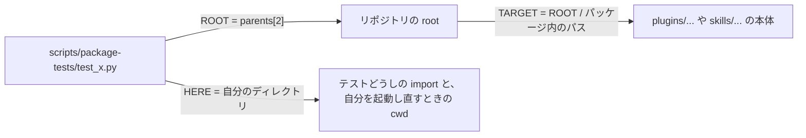

# ISSUE-76 plan: 配布物のテストを scripts/package-tests/ へ移す

決めたこと (2026-10-21、Hidari):

- 移す。apm 0.33.0 にも作者がファイルを外す手段は無い (ソース・ドキュメント・help・実機 install で確認)。上流の要望 (microsoft/apm の Issue 3215) は open のままで、triage のコメントは「skill フォルダの外に置く」を今日できる方法として示している
- 置き場は `scripts/package-tests/` (basename は変えない)
- `.mjs` の 2 本も同じ PR で移す
- 再発防止の規約 8 は、`scripts/check-package-shape.py` を関数化して本物の unittest で書く

この PR では ISSUE-76 を閉じない。タスク 4 (展開先にテストが届いていないことの確認) は、リリースと消費側の pin 上げの後にしか実行できないため。

## 対象

`git ls-files plugins skills | grep -E '(^|/)test_[^/]*\.py$|\.test\.mjs$'` の 13 本 (2026-10-21 に数え直した):

- dev-workflow: `commit-and-pr-message/scripts/` の `test_check_leak_guard_denylist.py` と `test_check_outgoing_text.py`、`in-repo-issue/scripts/test_issue_id.py`
- `skills/devops/macos-vm-verification/test_macvm.py`、`skills/devops/windows-vm-verification/test_winvm.py`
- `skills/tooling/jev-lint-curated/scripts/test_jevlint*.py` の 6 本
- `plugins/security-blue-red-team/schemas/tests/cleanup-queue.schema.test.mjs`、`plugins/web-monkey-qa/schemas/tests/findings.schema.test.mjs`

## 対象の指し方

- 各テストは先頭で `ROOT` / `HERE` / `TARGET` を定める。`TARGET` の literal は 1 本につき 1 つにする
- 本体を `import` で読むテスト (macvm、winvm、jevlint の 6 本) は、製品の import の直前で `TARGET` を `sys.path` の先頭へ足す。jevlint の本体は兄弟を素の `import jevlint_*` で読むので、パスで読み込む形では代わりにならない
- `HERE` は「テストの置き場」の意味に固定する。`test_issue_id.py` が自分を子プロセスで起動し直すときの `cwd=str(HERE)` は、移したあとも正しいので触らない
- `.mjs` は `import.meta.url` からの相対で schema を読む。移した先からは `..` を 2 つ上がって `plugins/<pkg>/schemas/` を指す

## コミットの切り方

| コミット | 中身 | 境界でコントローラが確かめること |
| --- | --- | --- |
| A 準備 | 置き場を動かさずに、移動で意味が変わる 2 箇所を分ける。`test_jevlint.py` の `HERE.glob("jevlint*.py")` (2 箇所) を製品側とテスト側に分け、両方が空でないことを別々に assert する。`test_check_outgoing_text.py` の禁止語 `str(HERE)` を製品ディレクトリの名前に変える | manifest の diff が空。runner が緑。製品側の glob を空にすると赤 |
| B 移動 | `git mv` の 13 本と、上の「対象の指し方」の手当てだけ。テストの増減と改名を入れない。`--update-manifest` で作り直す | `git diff -M --name-status main` で 13 件が rename。相対パスを除いた ID 集合が移す前と一致する。未記録側が全て `scripts/package-tests/` の下。`env -u PYTHONPATH` で runner が緑。`node --test scripts/package-tests/*.test.mjs` が 17/17。runner の所要時間を移す前 (127 秒) と比べる。禁止語の対照: 出力に `TARGET` を混ぜると赤、`HERE` を混ぜても緑 |
| C 規約 8 | `check-package-shape.py` を root を引数で受ける関数へ分け、CLI (引数なしで自分の root を見る、終了コード 0/1) は変えない。規約 8「plugins/ と skills/ の中にテストを置かない」を足す。Python 側は runner の `discover` を importlib で借り、`*.test.mjs` の glob だけを 1 箇所に持つ。テストは `scripts/test_check_package_shape.py` に TDD で書く | 実ツリーで規約 8 が 0 件。変異 3 種: パッケージ内に `test_probe.py` と `x.test.mjs` を置くと赤、規約 8 の判定を消すと赤、取り付け (pre-commit と CI が呼ぶこと) を外すと赤 |
| D 散文 | テストの置き場を前提にした記述を実態に合わせる (棚卸しの一覧は下) | 各記述が実態と合うことを読んで確かめる |
| E Issue | ISSUE-76 のタスク 1〜3 を消化して `in_progress` に。ISSUE-55 (R2 の制約が外れた)、ISSUE-34 (`.mjs` の新しいパス)、ISSUE-68 (移動の制約は消化済み) へ追記 | `check-issue-closure.py` が緑 |

## 散文の棚卸し (コミット D)

- `scripts/run-python-tests.py`: docstring の「検証対象と同じディレクトリ」、cwd を切り替える理由、`child_env` の「配られるので各テストファイルも自前で消毒する」の射程、`SKIP_DIRS` のコメントが `check-package-shape.py` を参照する向き (規約 8 が runner を借りると逆向きになる)
- `scripts/test_check_related_refs.py` と `scripts/test_issue_id_attachment.py` の、配布物のテストの置き場を名指すコメント
- `check-leak-guard-denylist.py` の、テストのファイルを名指す説明
- 移した各テストの docstring の実行例 (`python3 -m unittest` は `scripts/package-tests/` に入ってから)
- `test_check_outgoing_text.py` の「配布先でも同じ位置関係で」

## PR に入れないもの

- GIT_ENV の共有モジュール化 (ISSUE-55 の後続)
- 上流の Issue へのコメント (PUBLIC な面なので Hidari の判断)
- dotfiles 側の flat の写し (dotfiles の ISSUE-40 の持ち物)
